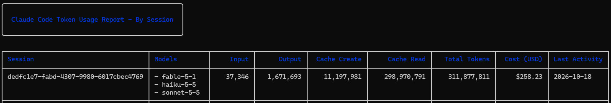

# Devlog 1 · How PKSEI was made in two days (a recipe)

PKSEI (*Paddla Kanot Som En Idiot*) is a rage game about four drunk guys paddling a canoe catamaran across a lake while they drink, talk and fall in. It is also a tech demo for [Godot Director](https://github.com/Freakling/Godot-Director), which is [Director-Driven Development](https://freakling.github.io/Director-Driven-Development/) for Godot: the human directs, AI agents build, and one automatic check decides when a task is done. This post is the log of how the game got from an empty folder to the build on [itch.io](https://freakling.itch.io/pksei), written as a recipe you can follow for your own game. The whole repository, records included, is on [GitHub](https://github.com/Freakling/PKSEI): the design document, the decisions log and the task list read as the diary of everything below. The same story told from the framework's side is the [PKSEI example page](https://freakling.github.io/Director-Driven-Development/examples/pksei/) on the Director-Driven Development site.

The numbers, as of the build this post describes:

| | |
|---|---|
| Time | two days (an evening, then a long day) |
| Commits | 104, one item each |
| Task items | 77, plus 6 bugs |
| Decisions recorded | 89 lines, each with its reason |
| Tests | 285 in 46 files |
| Tunables still marked placeholder | 116 |
| Builds shipped to itch.io | after every stage, about twenty |

The loop the whole time was the same four words: **Decide, Build, Prove, Commit.**

## 1. Install the workflow (10 minutes)

Empty folder, `git init`, then the Godot Director install. It writes the files the agents read: `AGENTS.md` (instructions and architecture), `design/gdd.md` (the design document), `design/decisions.md` (why each decision was made), `TASKS.md` (the work), `tools/check.sh` (the project check) and a pre-commit hook that runs the check.

The install ends with a design interview. I was asked, as multiple-choice questions with a recommendation each: the pitch, the genre and feeling, three to five design pillars, the core loop at three scales, the platforms, input, canvas and camera, and who owns what (I own design, balance and priorities; the agent owns code, tests, placeholder art and the records; here I let it make pixel art, sound and the player-facing text too). Every answer went into the GDD as the current design and into `decisions.md` as one line with its reason. Anything undecided became a numbered open question.

**Recipe:** answer the interview honestly and briefly. Pillars matter most; everything later gets checked against them. Mine were *Hard but fair*, *Four bodies, one brain*, *Drunker is funnier* and *No death, only setbacks*.

## 2. Ship before there is a game (20 minutes)

Second task, not last: a web export preset and a `tools/ship.sh` that exports headless and pushes to itch.io with butler. The first push was a flat blue screen with a label. From then on, "ship it" was one command and every stage of the game went to the page.

**Recipe:** get the pipeline working while the project is trivial. Export templates, butler login and the page settings are the only steps the human has to do by hand. Never paste an API key into the chat; the agent will refuse it, and rightly.

## 3. Research, then decide (30 minutes)

The open questions were about the controls, the setbacks and what drunkenness does. Before deciding, the agent researched the reference games (Getting Over It, A Difficult Game About Climbing, Jump King, Pogostuck, QWOP, plus Octodad and Heave Ho for multi-limb comedy) and wrote eight principles checked against the pillars. Then each question came back as two to four options with a recommendation. I picked, and sometimes changed the proposal: the scrambled keys became a timing bar, the setback became a man-overboard rescue instead of a capsize, the current became the game's gravity.

Every answer was recorded the same way: the GDD section rewritten, a decision line appended, the question deleted, and the task items updated. That consistency is what lets a fresh agent context pick up the work later.

**Recipe:** let the agent research and propose; you decide. Write down only what you decided, including the reason. When an answer contradicts a pillar, the agent must say so and ask which gives way, not reinterpret.

## 4. Build the foundation with `/next-task` (one hour)

"Do the next task until blocked." Each item in `TASKS.md` has a size, the files it touches, and outcomes tagged *(test)*, *(check)* or *(play)*. A builder agent gets one item in a fresh context, builds it, runs the check, and returns a report of about twenty lines. The orchestrating session reads only that report, updates the records, and commits one item per commit. Small items went to a cheaper model, medium ones to a mid-tier one, and the session's own model was kept for design.

Order: folder layout, the `RunState` autoload (the current attempt), then three pure rule classes with tests before any scene existed: paddling (charge-and-release strokes against the current, seats steering 80/20 back to front), drunkenness (lag, misses, the timing-bar tier) and stamina (strokes burn it, breaks are telegraphed). Only then the grey-box lake: a boat of rectangles, four coloured squares, a HUD, the island.

The large items got an independent review in a fresh context before their commit. The first review found six tunables sitting on scene scripts instead of in the data resources, exactly the kind of drift a human reviewer would also miss at 11 pm.

**Recipe:** rules in pure classes with tests first, scenes after. Let the check enforce the architecture: screens that roll randomness or write to autoloads fail the build.

## 5. Play it, and let the design change (30 minutes)

The first time I played the build, two things were wrong: the camera did not follow the boat, and the world felt like it moved around the boat instead of the boat moving through the world. The agent did not take my word for the camera; it wrote a throwaway harness that paddled the boat for ten seconds and logged positions and screenshots. The log showed the boat moving and the camera stuck at the origin: a hand-written scene file was missing the one marker Godot needs to resolve an exported node. One-line fix.

The second point was design. We moved from drifting hazards to a static map with fixed objects and timed events, a guaranteed winding path through the seeded bands, a huge lake sized for a five-minute clean crossing, a slow drift for the boat and a fast one for anything in the water, and a pause before a guy jumps after a beer. Six items, recorded and built the same evening.

**Recipe:** play early, then record what you learned as decisions, not as patches. The queue reorders itself around them.

## 6. The hazard set (one and a half hours)

Nine hazards, each a pure rule class stepped by a small scene script: the log, the angry geese guarding goslings, the rock, the fishing line, the motorboat wake, gusts and harsh-wind stretches, the cross-current stripe, the jet-ski idiot, and later the Loch-Brez beast that comes for you if you stray to the edges. Every one is telegraphed before it bites, because the first pillar says so. A shared effects palette (beer overboard, shove, snag, stop, forced break, water aboard) kept them consistent. Follow-up items came out of each build's report: events placed on the path so they can fire, objects keeping their footprint out of the corridor, a shared base script.

## 7. Art and sound, generated (two hours)

No imaging library on the machine, so the sprites are drawn pixel by pixel by a Godot script (`tools/gen_sprites.gd`) and the sounds synthesised by another (`tools/gen_audio.gd`). Both are committed, so the art is reproducible and editable in code. Telegraphs came first: every warning the rules emit got its own animation frames and its own sound before any decoration. The win cutscene, the antics (stand up, drop the paddle, nod off, pee, and later puke at the top of the meter), off-screen arrows for swimmers, the controls scratched into the sand at the launch shore, reverse strokes on eight keys, and the beast followed, each as one item, one commit. The itch.io cover is generated the same way, from the game's own sprites with four speech bubbles over them, at three resolutions.

## 8. The second day: play, say, fix, ship (most of a day)

Day two was played on a laptop and a phone, and each round of play became a short list of changes. The pattern was always the same: I said what was wrong in a sentence, the agent turned it into an item or a data change, built it, and shipped. Some of what came out of it:

- **The guys talk.** Every telegraph became a Swedish speech bubble ("Jag måste pissa", "Nu jävlar blåser det!"), one guy calls out each hazard, and a guy in the water keeps talking: fetching his beer, drinking it ("Ska bara dricka sen kommer jag"), then nagging to be fetched ("Kom och hämta mig dåååå!"). The lines live in one data file I can edit.
- **Names, not keys.** The guys draw nicknames from the real crew's list each attempt, and the HUD shows the names. The control scheme stays in the sand.
- **Touch controls, twice.** First version: four pads laid out like the keys, flick down for reverse. On a real phone the flick was slow and unreliable, so the second version reads the press position: on or above a line low on the pad is forward, below it reverse, and the pads moved down to where thumbs rest.
- **The beast, tuned three times.** It appeared too often (random visits cut to less than one per crossing), the guaranteed path was found to lead into its warning band (a bug with a regression test), and it spat guys out too far (halved).
- **Mercy rules.** Swimmers start swimming back after five seconds, slightly slower than the drift; drunkenness comes down by puking at the top and a little by peeing; reversed controls last ten to fifteen seconds, not forever; an emptied boat drifts home at five times speed so nobody waits for the reset.
- **Obstacles where you go.** Logs and rocks were spread across a 1600 px lake while the player sees 640; now objects land within 300 px of the corridor and the obstacle weights tripled. The builder noticed the fishing line's footprint needed 260 px of clearance and would never spawn at the 240 I had specified, and reported it with three options instead of guessing.
- **The phone showed a third of the screen.** Integer scaling could only show the 640×360 canvas at whole multiples, so an iPhone in landscape got 1×. One setting, verified in a browser emulator at three sizes before shipping.

**Recipe:** play on the real device early. One sentence of feedback is enough for the agent when the records are in order; the item it writes back tells you whether it understood.

## 9. Upgrading the workflow mid-project (30 minutes)

Godot Director's latest release, v3.13.0, came out while the game was being built, and its development branch already carried the next features, in an open pull request ([Freakling/Godot-Director#25](https://github.com/Freakling/Godot-Director/pull/25)): a play log, autoplay (the game playing itself through its own input), an in-game dev menu on F12 in debug builds, a screen capture tool and a release procedure. This game was upgraded in place from a snapshot of that branch, which still reported itself as 3.13.0, so it got the release plus the unreleased work, and that is what `.godot-director/manifest` and the framework files under `tools/` record. The installer kept the game's own files, flagged the one conflict (the Claude settings, which the agent may not edit itself) and read me the changelog as questions: how deep to go, where the dev menu lives, whether to replace the ship script. The wiring of the play log, autoplay and dev menu went into the queue as three items rather than being done silently in the upgrade commit, and until they are built the game uses none of the three.

**Recipe:** upgrade the workflow like any other change: one commit, the decisions recorded, the follow-ups as items.

## 10. What the check and the reviews caught

Across the two days the pre-commit check ran well over a hundred times and the reviews and builders' reports found, among others: a design call the builder had made silently about the shore reset, a swimmer who could drift past the shoreline out of reach, a wind-up that could expire unseen while a guy was in the water, a hit that could land during the win cutscene, a gameplay constant hiding as a cosmetic one, the guaranteed path leading into the beast's water, a spawn window too narrow for the widest hazard, and a floating-point edge on the touch pads' forward/reverse line that made a press exactly on the line reverse. None of these were bugs I would have filed from playing. All became either a fix in the same item or a new item in the queue.

## 11. What it cost

Claude Code reports token use per session. This is the row for the session that built the game, from the empty folder on 2026-10-16 to the last build on 2026-10-18. It includes the builder, reviewer and researcher subagents that session started, which is why three models are listed: the main session ran on Fable 5.1, `S` items were built on Haiku and `M` items on Sonnet. It runs past the numbers table at the top: by its end the game had 125 commits and 92 done items.

| | |
|---|---|
| Input tokens | 37,346 |
| Output tokens | 1,671,693 |
| Cache writes | 11,197,981 |
| Cache reads | 298,970,791 |
| Total tokens | 311,877,811 |
| Cost | $258.23 |
| Per commit | about $2.07 |
| Per done item | about $2.81 |

Almost all of it, 96% of the tokens, is cache reads: every turn re-reads the conversation and the records the agents work from, and a cached read is billed at a small fraction of fresh input. Fresh input is tiny, because the director's messages are a sentence or two each. Output, the code, the tests, the records and the reports, is about half a percent of the tokens.

**Recipe:** let model sizing do its job: small items on a small model, a fresh context per item, and an orchestrating session that keeps to decisions and bookkeeping while the builders do the reading. The report doesn't split the cost by model, so measure your own split before tuning it.

## The recipe, short

1. Install Godot Director; answer the interview; write the pillars.
2. Get the ship pipeline working on an empty scene.
3. Research the references; decide the open questions as options; record every decision with its reason.
4. Build rules with tests before scenes; one item, one commit; review the large ones.
5. Play, on the real device, then record what changed as decisions.
6. Keep every follow-up as an item, never as silent work.
7. Generate placeholder art, sound and even the cover from scripts; telegraphs first.
8. Ship after every stage.
9. Upgrade the workflow like any other change.

Next: wire the play log and autoplay so the game can playtest itself, local co-op (one guy per player), and balancing the 116 placeholders by playing.
